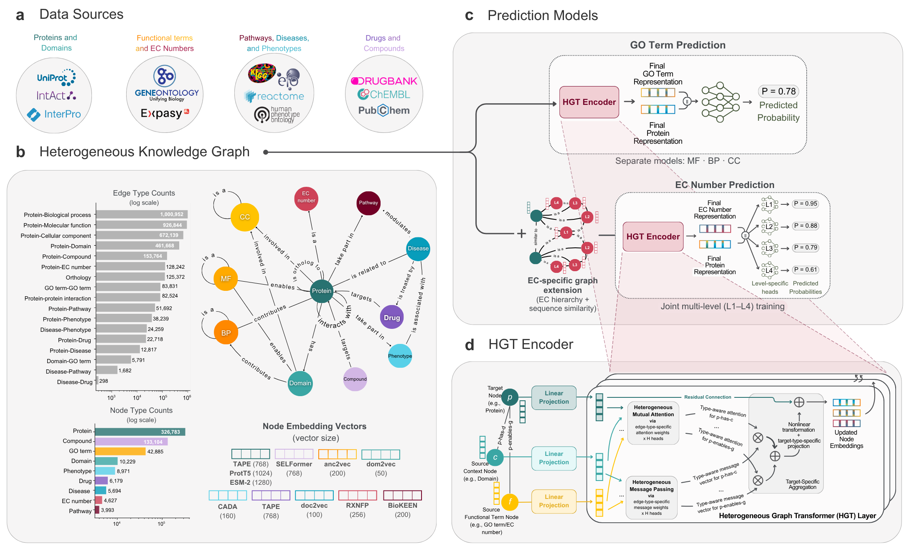

# ProtHGT: Heterogeneous Graph Transformers for Automated Protein Function Prediction Using Knowledge Graphs and Language Models
[](https://www.biorxiv.org/content/10.1101/2025.04.19.649272v1) [](https://huggingface.co/spaces/HUBioDataLab/ProtHGT) [](http://www.gnu.org/licenses/)


The rapid accumulation of protein sequence data, coupled with the slow pace of experimental annotations, creates a critical need for computational methods to predict protein functions. Existing models often rely on limited data types, such as sequence-based features or protein-protein interactions (PPIs), failing to capture the complex molecular relationships in biological systems. To address this, we developed ProtHGT, a heterogeneous graph transformer-based model that integrates diverse biological datasets into a unified framework using knowledge graphs for accurate and interpretable protein function prediction.
ProtHGT achieves state-of-the-art performance on benchmark datasets, demonstrating its ability to outperform current graph-based and sequence-based approaches. By leveraging diverse biological entity types and highly representative protein language model embeddings at the input level, the model effectively learns complex biological relationships, enabling accurate predictions across all Gene Ontology (GO) sub-ontologies. Ablation analyses highlight the critical role of heterogeneous data integration in achieving robust predictions. Finally, our use-case study has indicated that it’s possible to interpret ProtHGT’s predictions via exploring the related parts of our input biological knowledge graph, offering plausible explanations to build or test new hypotheses.

|  | 
|:--:| 
| **Figure 1. The overview of ProtHGT.** **(a)** Multiple biological entity types and their relationships are integrated from diverse source databases, including proteins, GO terms, compounds, domains, phenotypes, drugs, diseases, EC numbers, and pathways. **(b)** The resulting heterogeneous knowledge graph comprises multiple node and relationship types, with node- and edge-type distributions shown on logarithmic scales and initial node features derived using data-type-specific embedding methods. **(c)** For GO term prediction, separate models are trained for the molecular function (MF), biological process (BP), and cellular component (CC) sub-ontologies, with the refined protein and GO term representations combined for link prediction. For EC number prediction, the base graph is extended with the four-level EC hierarchy and protein sequence-similarity relationships, and the refined protein and EC representations are combined across four level-specific prediction heads that are jointly trained to predict functions from the main class (L1) to complete EC numbers (L4). **(d)** The heterogeneous graph transformer (HGT) encoder architecture is common to both tasks, although each model is trained independently. The encoder performs type-aware attention, message passing, and aggregation across heterogeneous node and edge types to generate contextually refined node representations. The encoder updates the representations of all node types in the graph; for clarity, only those used in the prediction step and one additional context node are shown. |

## Content <!-- omit in toc -->
- [The Architecture of ProtHGT](#the-architecture-of-prothgt)
- [Repository Structure](#repository-structure)
- [Getting Started](#getting-started)
- [Training the ProtHGT Model](#training-the-prothgt-model)
- [Making Predictions](#making-predictions)
- [Predicting EC Numbers](#predicting-ec-numbers)
- [Publication](#publication)
- [License](#license)


## The Architecture of ProtHGT

ProtHGT builds upon the **Heterogeneous Graph Transformer (HGT)** architecture, consisting of multiple stacked transformer layers to refine node embeddings while preserving node-type and edge-type diversity. 

### 1. Input Feature Transformation  
Each node type (e.g., Protein, GO Term) is projected into a shared hidden space using independent linear transformations:
```python
self.lin_dict = torch.nn.ModuleDict({
    node_type: Linear(data.x_dict[node_type].size(-1), hidden_channels)
    for node_type in data.node_types
})
```
This ensures that different biological entities have their own representation before message passing.

### 2. Heterogeneous Graph Transformer Layers

ProtHGT applies multiple HGT layers (``HGTConv`` implementation from PyTorch Geometric) to propagate information across node types using multi-head attention:

```python
self.convs = torch.nn.ModuleList()
for _ in range(num_layers):
    conv = HGTConv(hidden_channels, hidden_channels, data.metadata(), num_heads, group='sum')
    self.convs.append(conv)
```

### 3. Protein Function Prediction (Link Prediction)

ProtHGT models protein function prediction as a link prediction task between Protein and GO Term nodes.
The final embeddings of the two nodes are concatenated and passed through an MLP for classification:

```python
row, col = tr_edge_label_index
z = torch.cat([x_dict["Protein"][row], x_dict[target_type][col]], dim=-1)
return self.mlp(z).view(-1), x_dict
```
The MLP predicts the probability of a functional association between a protein and a GO term.


ProtHGT covers two tasks with the same architecture: **GO term prediction** (default) and **EC number prediction** (`src/ec/`). Data and model files are split accordingly into `go/` and `ec/` subdirectories.

- **data/**: Knowledge graph data for GO (`data/go/`) and EC (`data/ec/`). These files are hosted on [Hugging Face](https://huggingface.co/datasets/HUBioDataLab/ProtHGT) under `knowledge_graphs/`. Download and place them as described in [data/README.md](data/README.md).
- **models/**: Trained weights for GO (`models/go/`) and EC (`models/ec/`). These are hosted on Hugging Face under `models/`. Download and place them as described in [models/README.md](models/README.md). Each model is trained on its own KG—select the one matching your protein embedding type (TAPE / ESM-2 / ProtT5).
- **configs/**: Optimized hyperparameter and training config files, split by task: GO configs under `configs/go/` and EC configs under `configs/ec/` (each with an `alternative_protein_embeddings/` subdirectory for the ESM-2 / ProtT5 variants).
- **src/**: Main source code directory
  - `model.py`, `train.py`, `predict.py`, `utils.py`, `data_loader.py`: GO term prediction.
  - `ec/`: EC number prediction subpackage (`model.py`, `train.py`, `predict.py`, `eval.py`, `data_loader.py`). See [Predicting EC Numbers](#predicting-ec-numbers).
- **requirements.txt**: Lists all Python package dependencies

## Getting Started
We highly recommend you to use conda platform for installing dependencies properly. After installation of appropriate conda version for your operating system, create and activate conda environment with dependencies as below:

```sh
conda create -n prothgt
conda activate prothgt
```

Then, install the dependencies using the `requirements.txt` file:

```sh
pip install -r requirements.txt
```

## Training the ProtHGT Model
For training the ProtHGT model, run the `train.py` script with the following example command:

```sh
python train.py --train-data ../data/go/prothgt-train-graph.pt --val-data ../data/go/prothgt-val-graph.pt --test-data ../data/go/prothgt-test-graph.pt --target-type GO_term_F --config ../configs/go/prothgt-config-molecular-function.yaml
```

**Arguments:**
- `--train-data`: Path to the training data file
- `--val-data`: Path to the validation data file
- `--test-data`: Path to the test data file
- `--target-type`: Target prediction type. It can be one of the following: `GO_term_F` for molecular function, `GO_term_P` for biological process, and `GO_term_C` for cellular component.
- `--config`: Path to the configuration file. You can use your own or select from the optimized hyperparameter configurations in the `configs/go/` directory.
- `--output-dir`: Path to the output directory. Default is `../outputs`.
- `--checkpoint-dir`: Path to the checkpoint directory. Default is None.
- `--num-workers`: Number of workers for data loading. Default is 2.

Before running the training script, make sure that the data files are correctly placed in the `data/go/` directory (see [data/README.md](data/README.md)).

## Making Predictions

To generate function predictions for a given protein list using ProtHGT, you can either use our web-service here: [ProtHGT Web-Service](https://huggingface.co/spaces/HUBioDataLab/ProtHGT) or run the `predict.py` script with the following example command. This script uses pre-trained ProtHGT models (TAPE, ESM-2 or ProtT5 embeddings); download them from [Hugging Face](https://huggingface.co/datasets/HUBioDataLab/ProtHGT) into `models/go/` (see [models/README.md](models/README.md)).

```sh
python predict.py --protein_ids ../data/example_protein_ids.txt --protein_embedding tape --go_category all
```

**Arguments:**
- `--protein_ids`: You can either provide a text file containing a list of protein IDs or a comma-separated string of protein IDs.
- `--protein_embedding`: Protein embedding to use. It can be one of the following: `tape`, `prott5`, or `esm2`.
- `--go_category`: GO category to predict. It can be one of the following: `all`, `molecular_function`, `biological_process`, or `cellular_component`.
- `--output_dir`: Path to the output directory. Default is `../predictions`.
- `--batch_size`: Number of proteins to process in each batch. Default is 100.
- `--threshold`: Threshold for filtering predictions. Default is 0.0.
- `--top_k`: Keep only top-k GO terms per protein (0 = keep all). Default is 0.
- `--mask_existing`: Optional flag (off by default). Before inference, removes every GO annotation edge (`protein_function` and `rev_protein_function`) of the queried proteins from the input graph, for all three sub-ontologies regardless of `--go_category`. All other edge types are kept. Masking is applied to the whole query set at once, so results do not depend on `--batch_size`, and it is done in memory only; the KG file on disk is not changed.

The output file is a csv file containing the following columns:
- `UniProt_ID`: UniProt ID
- `Protein`: Protein name
- `GO_ID`: GO term ID
- `GO_term`: GO term name
- `GO_category`: GO term category. Either `Molecular Function`, `Biological Process`, or `Cellular Component`.
- `Probability`: Probability of the prediction.
- `known_annotation`: `True` if the (protein, GO term) pair is already a `protein_function` edge of that sub-ontology in the input knowledge graph. It always reports the status in the original KG, also when `--mask_existing` is set.

**Known annotations and `--mask_existing`.** By default, the queried proteins' existing GO annotations in the knowledge graph are visible to the model during message passing, so predictions amount to *annotation completion*: known terms typically receive high scores because they are part of the input. Use `known_annotation` to separate them from new candidate terms. With `--mask_existing`, all GO annotations of the queried proteins are hidden from the model, which simulates prediction for proteins without prior GO annotations. Use this mode for validation, for example to check whether known annotations are recovered from the remaining (non-GO) relations.

**Note:** Currently, ProtHGT can only generate predictions for proteins that exist in our knowledge graph, which includes over 300,000 UniProtKB/Swiss-Prot proteins. To enable predictions for novel proteins from their sequences, we are developing a real-time data retrieval system that dynamically fetches relational data from external sources (e.g., STRING, Reactome) and constructs a customized knowledge graph for inference. This system will allow ProtHGT to predict functions for previously unseen proteins by integrating newly acquired biological relationships.

## Predicting EC Numbers

ProtHGT also predicts Enzyme Commission (EC) numbers at all four hierarchy levels (L1–L4), using the same architecture, implemented in `src/ec/`. A single joint model per embedding shares one HGT backbone across four level-specific decoders.

### Training and reproduction
Run from inside `src/ec/` (the TAPE example shown; for ESM-2 / ProtT5 use the matching config and graphs under `alternative_protein_embeddings/`):
```sh
cd src/ec
python train.py \
  --train-data ../../data/ec/prothgt-ec-train-graph.pt \
  --val-data   ../../data/ec/prothgt-ec-val-graph.pt \
  --test-data  ../../data/ec/prothgt-ec-test-graph.pt \
  --config     ../../configs/ec/prothgt-ec-config.yaml
```

**Arguments:**
- `--train-data`: Path to the training data file
- `--val-data`: Path to the validation data file
- `--test-data`: Path to the test data file
- `--config`: Path to the configuration file. You can use your own or select from the optimized hyperparameter configurations in the `configs/ec/` directory.
- `--output-dir`: Path to the output directory. Default is `../../outputs`.
- `--checkpoint-dir`: Path to the checkpoint directory. Default is None.
- `--num-workers`: Number of workers for data loading. Default is 2.

At each checkpoint the script reports the per-level precision, recall, F1 and ROC-AUC on the test set, scoring each level independently (every EC level is evaluated against its own full set of classes).

### Prediction
```sh
cd src/ec
python predict.py --protein_ids ../../data/example_protein_ids.txt --protein_embedding tape --ec_level all
```
**Arguments:**
- `--protein_ids`: You can either provide a text file containing a list of protein IDs or a comma-separated string of protein IDs.
- `--protein_embedding`: Protein embedding to use. It can be one of the following: `tape`, `prott5`, or `esm2`.
- `--ec_level`: Deepest EC hierarchy level to predict. It can be one of the following: `all`, `1`, `2`, `3`, or `4`.
- `--output_dir`: Path to the output directory. Default is `../../predictions`.
- `--threshold`: Probability threshold for keeping a prediction at each level. Default is 0.5.
- `--top_k`: Keep only top-k candidates per protein per level (0 = keep all above threshold). Default is 0.
- `--mask_existing`: Optional flag (off by default). Before inference, removes all protein–EC annotation edges of the queried proteins from the input graph, at every level (`protein_ec1`, `protein_ec2`, `protein_ec3`, `protein_ec`) and in both directions (including the `rev_` edge types). The EC class hierarchy edges (`ec_parent_*`) and all other edge types are kept. Masking is applied to the whole query set at once and in memory only; the KG file on disk is not changed.

The output file is a csv file containing the following columns:
- `UniProt_ID`: UniProt ID
- `Protein`: Protein name
- `EC`: Predicted EC number (or class prefix for levels L1–L3).
- `EC_name`: Enzyme name for complete EC numbers (L4) or class name for L1–L3 (from the ExPASy ENZYME nomenclature).
- `EC_level`: EC hierarchy level, one of `L1`, `L2`, `L3`, `L4`.
- `Probability`: Probability of the prediction.
- `known_annotation`: Whether the prediction is already an annotation of the protein in the input EC knowledge graph. For a complete EC number (L4), `True` if the protein has that EC number as a `protein_ec` edge. For L1–L3, `True` if the predicted class is a prefix of at least one of the protein's known complete EC numbers (e.g. a predicted `3.4.21` is known if the protein is annotated with `3.4.21.5`). The EC KG also stores explicit per-level protein edges (`protein_ec1/2/3`); these are exactly the prefixes of each protein's L4 numbers, so both definitions give the same result. The column always reports the status in the original KG, also when `--mask_existing` is set.

**Known annotations and `--mask_existing`.** By default, the queried proteins' existing EC annotations in the knowledge graph are visible to the model during message passing, so predictions amount to *annotation completion*: known EC numbers typically receive high scores because they are part of the input. Use `known_annotation` to separate them from new candidates. With `--mask_existing`, all EC annotations of the queried proteins are hidden from the model, which simulates prediction for proteins without prior EC annotations. Use this mode for validation. Note that the proteins' GO annotations and sequence-similarity edges remain visible in this mode, and they are often informative of the EC class.

Unlike the independent per-level scoring used for evaluation, `predict.py` runs the model as a top-down cascade: L1 is predicted first, and each deeper level is predicted only among the children of the levels kept above it. This yields hierarchically consistent predictions (every predicted L4 number has its predicted L3/L2/L1 ancestors), which is what you want when applying the model to new proteins; a prediction is kept at each level when its probability exceeds `--threshold`.

## Publication
Please refer to our preprint for more information. If you use the ProtHGT method or the datasets provided in this repository, please cite this paper:

Ulusoy, E., & Dogan, T. (2025). ProtHGT: Heterogeneous Graph Transformers for Automated Protein Function Prediction Using Biological Knowledge Graphs and Language Models (p. 2025.04.19.649272). bioRxiv. [Link](https://doi.org/10.1101/2025.04.19.649272)

## License
Copyright (C) 2025 HUBioDataLab

This program is free software: you can redistribute it and/or modify it under the terms of the GNU General Public License as published by the Free Software Foundation, either version 3 of the License, or (at your option) any later version.

This program is distributed in the hope that it will be useful, but WITHOUT ANY WARRANTY; without even the implied warranty of MERCHANTABILITY or FITNESS FOR A PARTICULAR PURPOSE. See the GNU General Public License for more details.

You should have received a copy of the GNU General Public License along with this program. If not, see http://www.gnu.org/licenses/.
